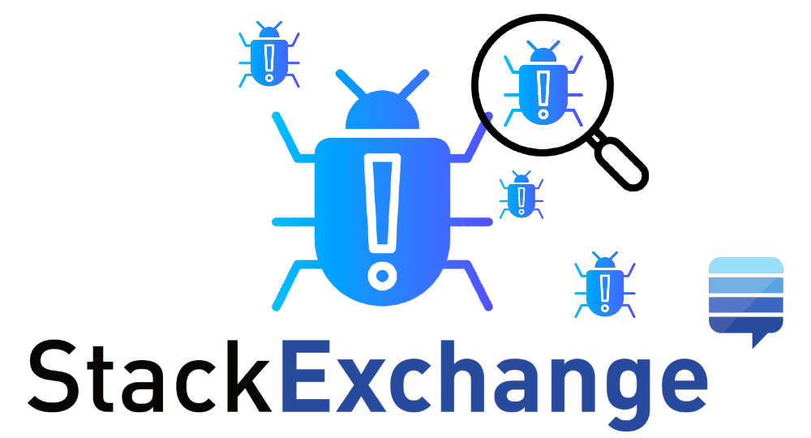
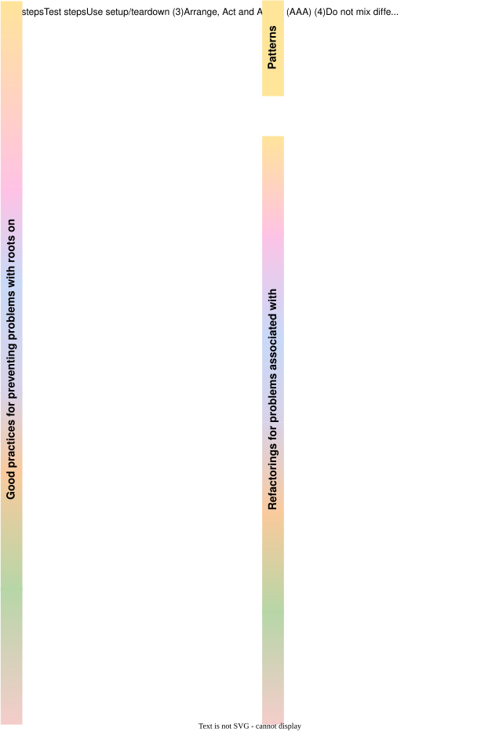

 
 <h2>Welcome 👋</h2>

📌 This reade.me syntheses the main categories of <b>test smells</b> and smelly test code <b>refactoring</b> based on Q&A's posted on Stack Exchange sites (e.g. Code Review, Software Engineering, Stack Overflow). This synthesis is the result of the investigation carried out in the <i>"Investigating the developer discussions in Stack Exchange network to guide fixing test smells"</i> study.

📎 Link to paper <a href="https://github.com/railana/testsmells">[not available]</a>

📋 <b>Abstract:</b> Refactorings are transformations to improve the design of the code without changing overall functionality and observable behavior. During the refactoring process of smelly test code, practitioners may struggle to identify refactoring candidates, define and apply the corrective strategy. However, little is known about challenges and real issues related to testing anti-patterns, the most used strategies discussed in the gray literature. This paper aims to understand how the topics of test smells and test refactorings are discussed among developers in online discussion forums. We explore how test smells are understood and perceived by developers, what corrective actions developers take to deal with them, and what challenges developers face when refactoring the test code to fix test smells. Our findings show that practitioners have more difficulty identifying whether or not a given practice is considered an anti-pattern of the test code than the appropriate strategies for fixing these practices.
  

 <h2>Test smells 🐞</h2>

 ➡ See <a href="https://github.com/railana/testsmells/blob/main/testsmells.md" >definitions</a> of test smells

 <h2>Test code refactoring 🧹</h2>

 ➡ See <a href="https://github.com/railana/testsmells/blob/main/testcodrefactoring.md" >definitions</a> of refactorings

 <h2>Contributions 🤝</h2>

We welcome and encourage contributions to keep this summary up to date. Submit your pull request. 

